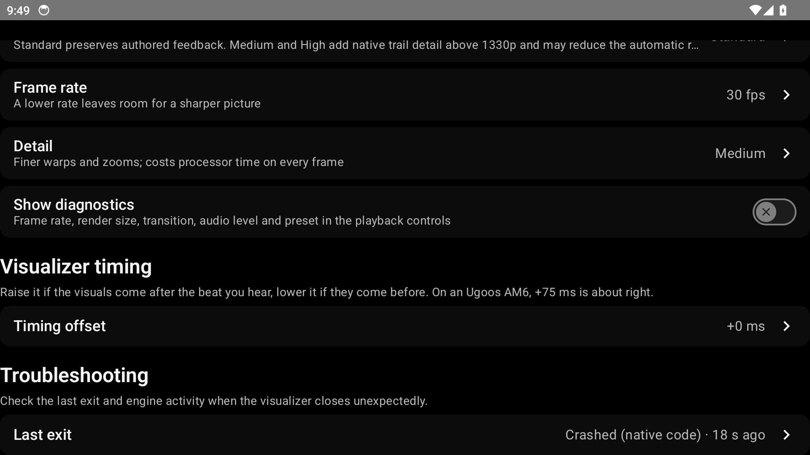
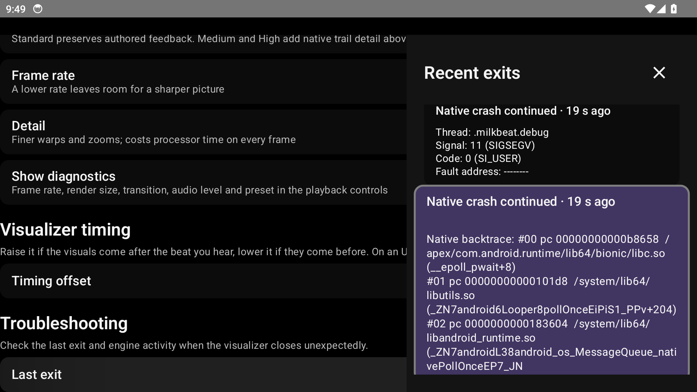
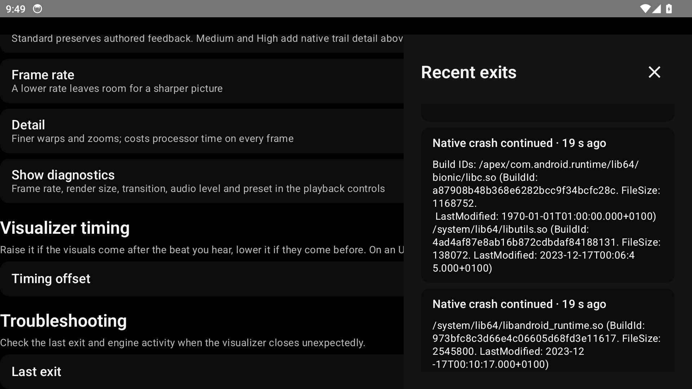

# Milkbeat native crash report consumer validation

Date: 2026-10-16. Consumer implementation: `387918f1e850a1460ee67bc582f8d3b227a0604a`,
following switch retirement in `be69eb4ac965c1b5a0e07a884ebd9263ce5971a6`.
This is local consumer validation, before publication of the new ProjectM TV core API.

## Final candidate identity

The source-built `core-release.aar` supplied by the ProjectM TV task has SHA-256:

```text
814e25641209f5e03b5106772c4dd1cd28e1b6370250b6e902371bf35371cb54
```

The copied bytes were checked against that hash before testing. The isolated Ivy repository
`/tmp/milkbeat-firetv-final-core-repo` contains those bytes at
`download/vfiretv-final-814e2564/projectM-TV-core-firetv-final-814e2564.aar`.
The distinct revision avoids reusing the earlier candidate's dependency identity. The AAR's
`classes.jar` contains `NativeCrashReports.class` and
`META-INF/licenses/xcrash-LICENSE.txt`. No local AAR or repository override is committed.

## Final candidate checks

Run from the task worktree:

```bash
./gradlew ktlintCheck :app:testGithubDebugUnitTest --tests '*Visualizer*' :app:compileFossDebugKotlin -PprojectmCoreRepo=/tmp/milkbeat-firetv-final-core-repo -PprojectmCoreVersion=firetv-final-814e2564 --max-workers=1
```

Result: exit 0, `BUILD SUCCESSFUL`. All 36 selected tests passed with zero failures and errors.
The GitHub and FOSS Kotlin compile tasks restored valid outputs from the build cache; the unit
test task executed. Spotless/ktlint checks were up to date. Literal formatter fixtures cover
native signal/backtrace/build-ID display, no saved reports, long report continuation cards, and
historical Android exit/trail behavior. They are synthetic formatting controls, not captured
crash evidence.

The updated guide also passes `mkdocs build --strict`, using the versions pinned in
`docs/site-requirements.txt`. `git diff --check` passes.

## Earlier packaging check

The prior local AAR candidate had SHA-256
`c6f8f013ba078dc63b91f31661c0aa5df57673f7876204fdfc03d2912f7f6e3e`.
Against it, the same consumer source passed a GitHub debug APK build and 36 visualizer tests.
The universal APK had SHA-256
`c48dc755df8800aaeea911c5471a004f5121c34b11911e52ff242e30665a74d8`.
Its packaged manifest, inspected with `apkanalyzer`, has `extractNativeLibs=true`.
Both ARM ABIs contain compressed `libprojectmtv.so`, `libxcrash.so` and
`libxcrash_dumper.so`. Packaging configuration and the public consumer API are unchanged for
the final candidate; the APK build was not repeated for the final AAR.

## Remaining validation at the original checkpoint

No Milkbeat device journey or deliberate native fault was run during these consumer checks.
There is no affected Fire TV verification or crash-fix claim here. ProjectM TV's separate
capture/restart device evidence does not establish Milkbeat's device behavior. Publication,
current-head PR review, CI and merge remain separate gates. CI using the published core must
wait until the ProjectM TV release includes `NativeCrashReports`.

Native crash files remain private and excluded from Android backups, with no automatic upload.
Raw files can contain register/stack memory and fragments of app data. The Recent exits UI
uses the core's bounded display details and omits those raw memory sections.


## Published-core integration and device check — 2026-10-17

After merging main `b2dc3f00`, the consumer passes42 focused visualizer JVM controls,
ktlint and FOSS Kotlin compilation against the published core2.3.55. The earlier local
AAR candidate identities above remain historical records; `NativeCrashReports` is now
available in the published dependency.

The owned Android14/API34 ARM64 emulator at1920×1080/320dpi ran the GitHub debug app and
its instrumentation APK. The opt-in capture case initializes the real core recorder and
sends SIGSEGV to its own process. Instrumentation ends with `Process crashed`, as intended;
a62,508-byte private native file survives. The follow-up report case passes (`OK (1 test)`):
it reads the real saved report, opens Last exit, focuses the native backtrace card, reaches
Build IDs, and verifies that Back restores focus to the opener. Neither retired toggle is
present. This is a component/device journey using the actual reader, formatter and settings
pane, not a reproduction of the reporter's PowerVR driver fault. The header's unknown GPU
is expected: this fixture initializes capture without rendering a preset.

The opt-in cases are in `TvVisualizerCrashReportDeviceTest`; they skip unless their explicit
arguments are supplied. Run each method separately with the Hilt instrumentation runner:
`captureNativeCrashWhenExplicitlyRequested` with `projectmCrashCapture=true`, then
`savedNativeBacktraceIsReadableAndBackReturnsRemoteFocus` with `projectmCrashReport=true`.
Use only a disposable, task-owned device. The first run intentionally cannot pass as a normal
JUnit run because it terminates the process. The second run asserts the persisted result.

| Settings after restart | Focused native backtrace | Build IDs |
|---|---|---|
|  |  |  |

These are the owned emulator's unedited component-test captures. They are not personal
reporter photographs or physical-TV screenshots. The raw native file is not committed.


The GitHub debug and instrumentation builds pass, as does the shrunk GitHub Nightly build.
Both APK manifests declare `extractNativeLibs=true`; the ARM64 engine, recorder and dumper
are compressed for extraction in both. The UI journey above ran on the debug app; the shrunk
APK was inspected for packaging, not run through that journey. The [validation manifest](device-2026-10-17/validation.json)
records APK/test/source hashes, screenshots, device and check results. Strict MkDocs and
`git diff --check` pass. Final-head Codex review, CI, merge and publication remain separate.
