# Providers and sign-in

Streaming catalogs come from optional, separately distributed **plugins**. Local and network folders are built in and need none. A plugin can offer any mix of three capabilities, shown under its name in Settings → Plugins:

| Capability | What it supplies |
| --- | --- |
| **metadata** | A music tab with Home, Search, artist, album and playlist pages, and the account's library |
| **audio** | Playable streams, including matches for tracks from another provider's catalog |
| **video** | Video search and playback, and music videos in now playing |

There is no metadata provider to choose: every installed, enabled catalog you can use gets its own [music tab](library.md#a-tab-per-music-service). You only choose the order of audio providers and which plugin supplies video.

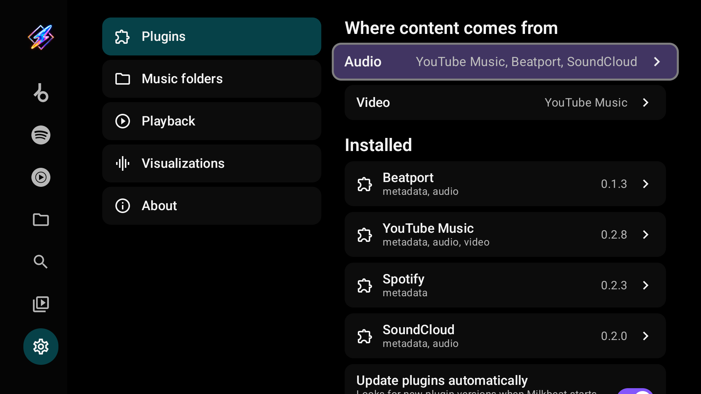

## The available plugins

| Plugin | Code | Catalog | Audio | Video |
| --- | --- | --- | --- | --- |
| YouTube | **563** | YouTube Music Home with mood chips, Search, artists, albums, playlists, library | YouTube streams, cross-provider matching and radio | Music videos |
| Spotify | **981** | Home, Search, artists, albums, playlists, library | **None: use another audio provider** | — |
| Beatport | **393** | Catalog, genres, charts, artists, labels, library | Full streams with a streaming subscription | — |
| SoundCloud | **089** | Discover, Stream, Search, Artists, albums, playlists, Liked Songs, history | Available full tracks, matching and stations | — |
| Deezer | **734** | Home, Flow, Search, artists, albums, playlists, library | Account streams and cross-provider matching | — |

Capabilities depend on the installed plugin version, the account and its subscription. The YouTube Music and YouTube Video plugins are retired; see [Retired plugins](#retired-plugins).

## YouTube

**YouTube 0.1.3** (downloader code **563**) is the one YouTube provider. It needs a Milkbeat build
with plugin API 11; update the app before installing if your build is older. Its **YouTube** tab
offers YouTube Music Home with mood chips, Search with YouTube Music's filters, artist, album and
playlist pages, your library and radio. It plays YouTube audio and music videos, through YouTube's
TV player first when you are signed in, and matches tracks from other catalogs.

The tab appears as soon as the plugin is installed and enabled; Home works signed out. While you
are not signed in, a line above the mood chips says so and offers **Sign in** and, in the stable
GitHub build, **Download MicroG-RE-TV**. Signing in uses the Google account in MicroG-RE-TV and
works only in the stable app; see [Sign in](#sign-in).

## Retired plugins

The **YouTube Music** and **YouTube Video** plugins are retired: the YouTube plugin (code **563**)
replaces both. Their downloader codes (**728**, **416** and **494** for YouTube Music; **932**,
**304** and **744** for YouTube Video) no longer install anything in current Milkbeat builds and
are never given to another plugin. Older Milkbeat releases may still resolve them from their
bundled catalog, but no new versions are published.

An installed YouTube Music or YouTube Video plugin keeps working but gets no more updates. Its
page in Settings → Plugins and its YouTube tab say it is retired and that YouTube (code 563)
replaces it, with **Add YouTube**: this opens Settings → Plugins with code 563 for you to review
and install. Once YouTube is installed, it holds the YouTube tab, also signed out, and the notice
says the old plugin can be removed:

1. Sign YouTube in with your [Google account](#sign-in); it does not use the old plugins' sign-in.
2. Check YouTube's place under [Audio](#set-audio-priority) and choose it under **Video**.
3. Open the retired plugin's details and select **Remove**.

YouTube 0.1.3 does not offer [private playlist preparation](#prepare-private-playlists). Once
YouTube Music is removed, Spotify playlists play with normal matching and radio, and copies it
prepared stay in your YouTube library.

## Deezer

**Deezer 0.2.1** provides Home with Flow, mixes and channels, Search, artist, album and playlist
pages, a read-only library and radio. Install it with code **734** on a Milkbeat build supporting
plugin API 9. Sign in with Deezer through the phone web viewer on the same network as the TV.
Its audio can play native Deezer tracks and accepted matches from other catalogs; stream
availability and FLAC or MP3 quality depend on the account, region and recording. It supplies
no video. Its encrypted streams cannot be downloaded for offline playback. On a Milkbeat build with
plugin API 10, Deezer 0.2.1 fetches each track in one request, so playback no longer pauses and
resumes during a song.

## Install a plugin

1. Open **Settings → Plugins** and scroll to **Add a plugin**.
2. Enter a registered three-digit code, or a plugin download URL (a `.mbplugin` file or a supported Buzzheavier file page; an address without a scheme defaults to HTTPS).
3. Select **Add a plugin**.
4. Review the plugin's author, description, capabilities and requested access, then select **Install**, **Update** for a newer version of an installed plugin, or **Reinstall** when the code or link fetches the version already installed. **Cancel** leaves everything as it was.

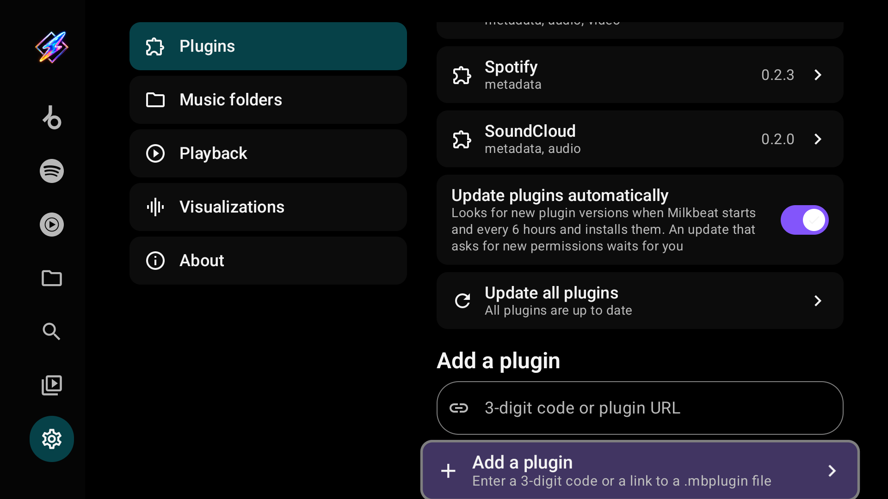

### Download codes

<!-- plugin-codes:user-guide -->
| Code | Plugin |
| --- | --- |
| **393** | Beatport |
| **981** | Spotify |
| **089** | SoundCloud |
| **734** | Deezer |
| **563** | YouTube |
<!-- /plugin-codes -->

Stable builds prefer the publisher's live catalog and fall back to the bundled one offline, so newly published codes work without an app update. The separate [Preview app](preview-testing.md) pins its codes to its own test catalog. The original codes **102** (Beatport) and **772** (Spotify) still work; codes of [retired plugins](#retired-plugins) do not. An unknown code reports an error; try the plugin's full URL or update Milkbeat.

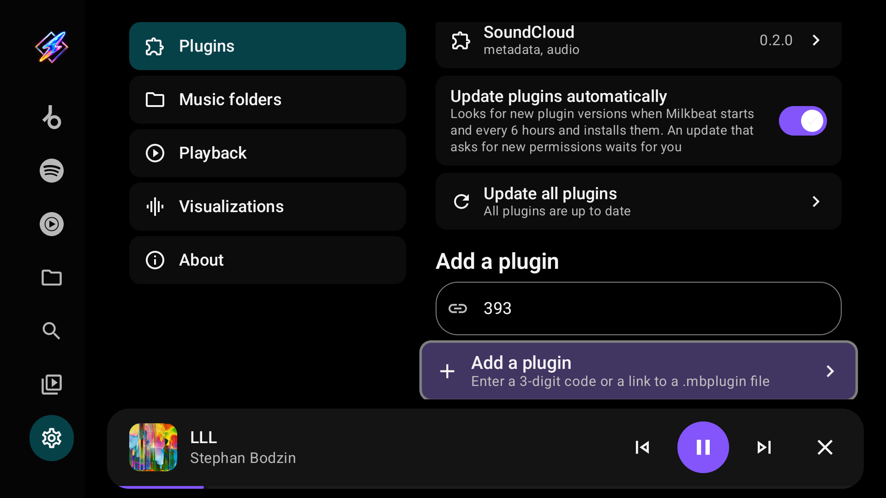
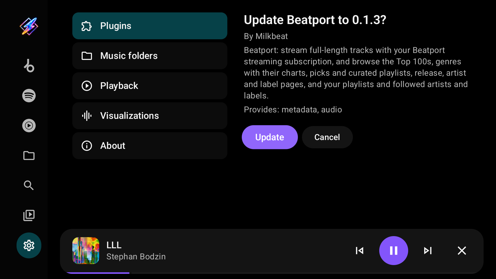

Milkbeat verifies a plugin's signature before offering installation. Buzzheavier sometimes asks to check the download in a browser; Milkbeat continues once the page lets it through.

A plugin built for a newer Milkbeat cannot be installed: Milkbeat reports *needs a newer version of Milkbeat* instead of an install review. When the publisher lists that requirement, Milkbeat says so for a code before downloading anything. The GitHub build adds **Update Milkbeat**, which opens [Settings → About](settings.md#about); update the app there, then add the plugin again. The FOSS build shows only the message, so update Milkbeat through its store.

## Keep plugins up to date

| Control | What it does |
| --- | --- |
| **Update plugins automatically** | On by default. Looks for new plugin versions when Milkbeat starts and every 6 hours and installs them. An update that asks for new permissions waits for your review |
| **Update all plugins** | Checks now and installs every available update. It reads *All plugins are up to date* when there is nothing to install, and lists any update that needs your review as **Update** *plugin* |

An update must come from the same signing author and cannot be older than the installed version. When updates were installed or need review, Milkbeat shows a short notice; reviews wait in Settings → Plugins. Entering a plugin's code or link again still works too. Plugin updates are separate from [app updates](settings.md#about).

### Updates that need a newer Milkbeat

A plugin version can require a newer Milkbeat than the one installed. Milkbeat does not download that version or retry it as a failed update. Instead, **Update all plugins** reads *1 update needs a newer version of Milkbeat* and lists the plugin as **Update** *plugin* with *Update Milkbeat first*. A background check shows a notice once each time Milkbeat starts. In the GitHub build, selecting the row opens [Settings → About](settings.md#about) to update the app. After the app is updated, the next plugin check installs that version as usual. The installed plugin version keeps working in the meantime.

## Plugin details

Select an installed plugin to see its version, description and account, and to sign in or out, report plays, index playlists or remove it. Removing a plugin never removes local music sources. Account names are blurred in these captures.

=== "Spotify"

    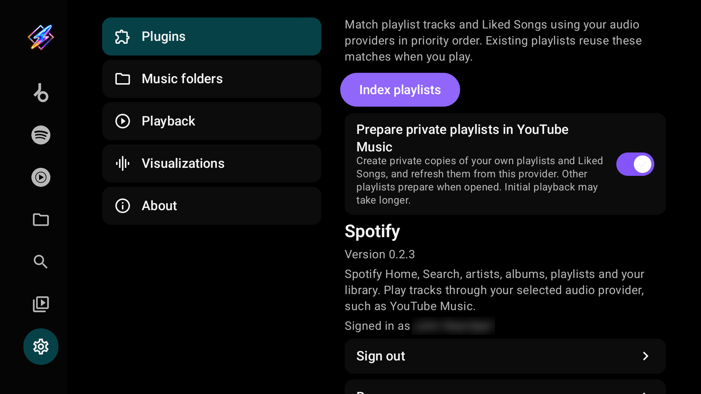

=== "Beatport"

    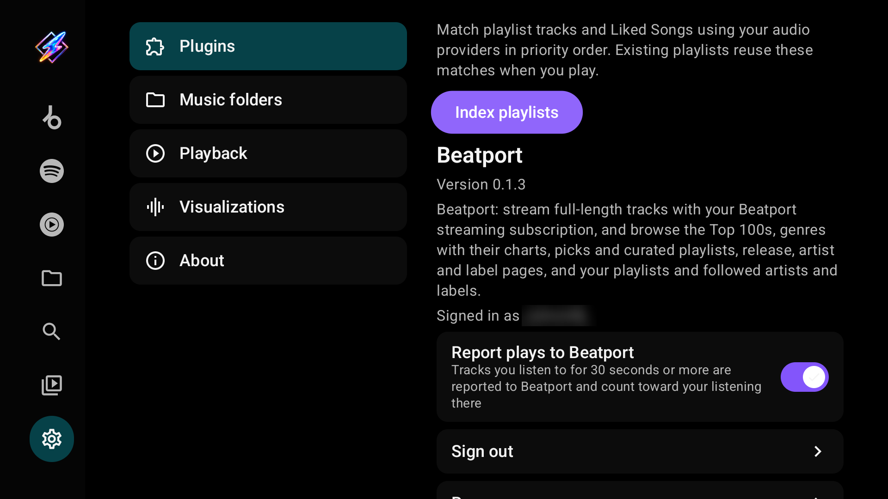

=== "SoundCloud"

    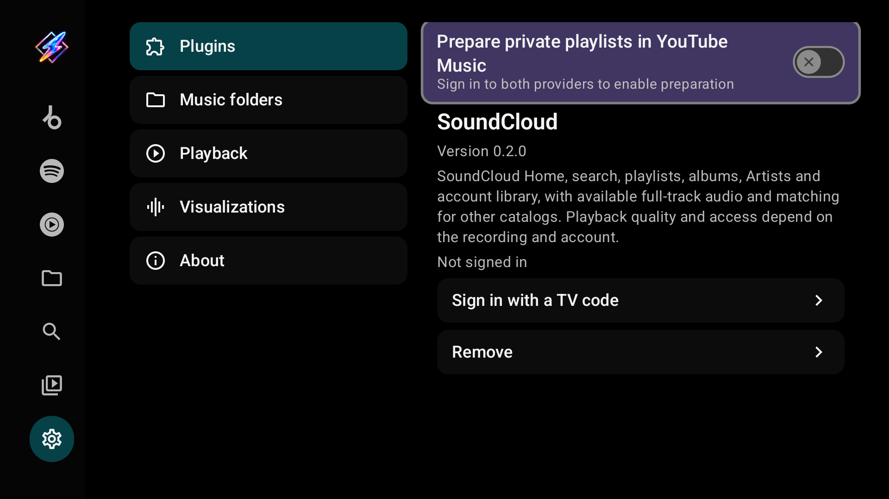

=== "YouTube Music (retired)"

    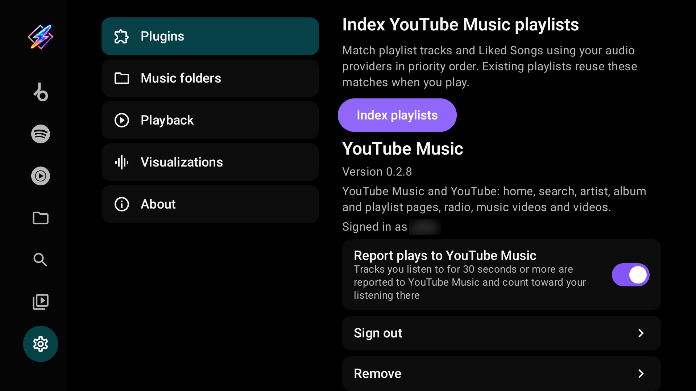

    The retired YouTube Music plugin, captured before it was retired; its page now also says that YouTube (code 563) replaces it.

| Item | What it does |
| --- | --- |
| **Index playlists** | Matches the account's playlist tracks and Liked Songs against your audio providers in priority order, so playback can reuse the matches |
| **Prepare private playlists in** *plugin* | Spotify, for each enabled audio plugin that can hold private playlists: see [below](#prepare-private-playlists). Needs both providers signed in |
| *Plugin* **is retired** / **Add YouTube** | Retired YouTube Music and YouTube Video plugins only: see [Retired plugins](#retired-plugins) |
| **Download MicroG-RE-TV** | Stable GitHub build, plugins that sign in with a [Google account](#sign-in), while not signed in |
| **Report plays to** *provider* | Tracks you listen to for 30 seconds or more, or for half of a track shorter than a minute, are reported to that provider. Compatible API 8 music providers receive updates during playback and at pause/seek/final boundaries; older providers report when the listen ends. Unknown-length tracks require 30 seconds. Skipped sections do not count as listening |
| **Signed in as** / **Not signed in** | The account state. *Signed out: sign in again* means the provider confirmed the session expired |
| **Sign in** / **Sign out** | Starts the provider's [sign-in method](#sign-in) or forgets the session |
| **Remove** | Uninstalls the plugin and its tab |

Completed indexing matches are kept when you cancel. Index again after changing the account or the audio-provider order.

## Sign-in and account requirements

- **YouTube:** sign-in is optional; Home works signed out. Signing in with the Google account in MicroG-RE-TV gives you your own Home, library and history. It works only in the stable app, not in Milkbeat Preview or debug builds. YouTube 0.1.3 needs a Milkbeat build with plugin API 11.
- **Deezer:** sign in through the phone web viewer for your catalog, Flow and read-only library. Audio availability and quality depend on the account and recording. Deezer 0.2.1 needs a Milkbeat build with plugin API 9.
- **Spotify:** a catalog with **no audio source**. Its value is your personalized feed, playlists, Liked Songs and library after signing in. Keep at least one audio provider enabled.
- **Beatport:** sign in for the catalog and your library. Beatport's own full-length audio needs an active streaming subscription; otherwise SoundCloud or YouTube can match the recording. A free account does not guarantee a match.
- **SoundCloud:** sign in for personalized Home, playlists, Liked Songs, history and Artists. Public search and catalog pages can work anonymously. Full-track availability depends on the recording and your listening subscription; Artist Pro does not grant Go+ listening rights. Preview-only or restricted recordings can appear but cannot supply full-track audio, so keep another audio provider as a fallback. SoundCloud plugin 0.2.0 needs a Milkbeat build with plugin API 5. TV-paired accounts currently play clear HLS streams only; protected-only recordings cannot play with this session, and plays from a TV-paired account are not reported to SoundCloud. Existing web sessions keep their Widevine playback path where the account and device allow it.

## Sign in

Open the installed plugin's details and choose its sign-in method.

**TV code pairing (SoundCloud):** select **Sign in with a TV code**, scan the QR code or open the displayed address on a phone or computer, sign in and approve the short code. The phone does not need to be on the TV's network. Keep the TV screen open while it waits: leaving it, pressing Back or sending Milkbeat to the background cancels the attempt, and an expired or declined code can be requested again. The plugin accepts the account only after its account and Home requests succeed.

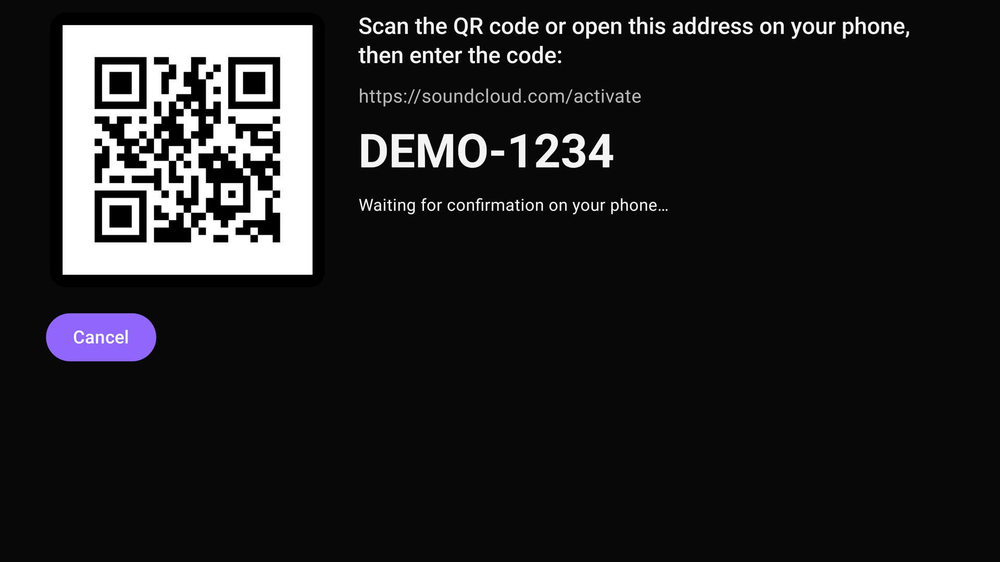

**Web sign-in (Spotify, Beatport and Deezer):** scan the TV's QR code with a phone on the same network. The [phone viewer](https://github.com/johnneerdael/Milkbeat/blob/main/docs/phone-sign-in-remote-view.md) streams the provider's real sign-in page from the TV; use touch and typing on the phone to complete sign-in and any verification. Browsing and playback stay in Milkbeat's TV interface.

**Google account through MicroG-RE-TV (plugins that offer it, such as YouTube, code 563):** select **Sign in with your Google account**. Everything happens on the TV with the remote; no phone is needed.

1. If MicroG-RE-TV is not installed, the stable GitHub build offers **Install MicroG-RE-TV**. It downloads the latest release from [MicroG-RE-TV](https://github.com/johnneerdael/MicroG-RE-TV/releases) and opens Android's install prompt. The first time, Android asks you to allow Milkbeat to install apps; allow it and press Back. The stable foss build asks you to install it yourself. Milkbeat Preview and debug builds cannot use this sign-in at all, so installing MicroG-RE-TV for them does not help. A MicroG-RE-TV older than 7.2.1.5 cannot sign Milkbeat in: the stable GitHub build offers **Update MicroG-RE-TV**, which installs the latest release over it and keeps your account, and the foss build asks you to update it. Other MicroG builds under the same package are used as they are.
2. Pick your Google account from MicroG-RE-TV in the TV's account picker. On affected Google TVs, Milkbeat opens Android's standard picker to show MicroG accounts; other TVs keep their configured picker. Regular Google accounts are excluded. If there is none yet, add it in MicroG-RE-TV when Android offers to.
3. MicroG-RE-TV 7.2.1.5 and later grant Milkbeat the access the plugin needs, such as "use your account as YouTube Music", without asking. If your MicroG build asks instead, select **Allow**; declining ends the attempt, and **Retry** asks again.

**Download MicroG-RE-TV** (stable GitHub build): while YouTube is not signed in, its tab shows a line above the mood chips with **Sign in** and **Download MicroG-RE-TV**, and Settings → Plugins → YouTube shows a **Download MicroG-RE-TV** row under the sign-in method. It downloads the [latest MicroG-RE-TV release](https://github.com/johnneerdael/MicroG-RE-TV/releases/latest) and installs it, also over an installed copy, which keeps its Google account; then sign-in continues with the account picker as above. If Milkbeat may not install apps yet, Android's setting for that opens first: allow it and press Back. **Sign in** starts the same sign-in without downloading anything. The foss build does not show the download button.

On TCL TVs, which stop apps from starting other apps in the background, Milkbeat starts MicroG-RE-TV itself while it signs you in. If sign-in or playback from the plugin still fails there, allow MicroG-RE-TV to start on its own with adb: `adb shell appops set app.revanced.android.gms AUTO_START allow`.

Milkbeat keeps the account name, never a password or token. MicroG-RE-TV keeps your grants and issues short-lived tokens; to withdraw access, remove it in MicroG-RE-TV. This sign-in works only in the stable app (`nl.neerdael.milkbeat`), not in Milkbeat Preview or debug builds.

When a provider reports an expired sign-in, Milkbeat asks the plugin again in the background, retrying temporary connection failures, and restores the account without any action when it still works; private playlist preparation then resumes on its own. An account the provider confirms expired needs sign-in again; local folders keep working.

## Set audio priority

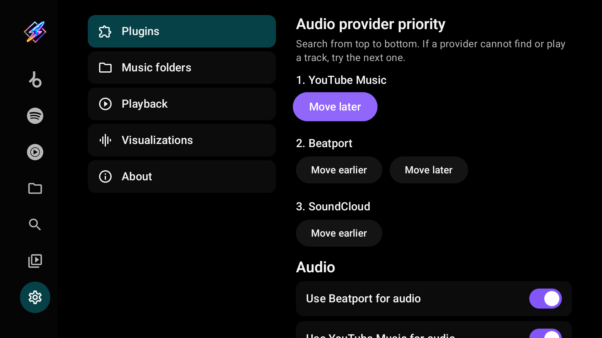

Under **Audio**, use **Move earlier** and **Move later** to order the providers, then select **Done**. Every track tries the providers in this order, including a track that comes from one of them: with YouTube above SoundCloud, a SoundCloud track is first looked up and played on YouTube, and its own SoundCloud stream is the fallback. When a provider's turn comes for one of its own tracks, it plays that track directly without a search.

Each provider's **play other services' tracks** switch decides whether it is in the order:

- **On:** the provider is in the order above and is used for every track in its turn.
- **Off:** the provider plays only its own tracks. It is tried first for those, and if it cannot play one, such as Beatport without a streaming subscription, the track continues down the order. It never searches for other services' tracks, even when one of them carries its ID. The **Audio** row in Settings → Plugins lists it after the order as *provider* (own tracks only).

Beatport starts with the switch off, and updating Milkbeat switches it off once for an existing setup; switch it on to add it to the order again. Updating a plugin keeps your choice.

Spotify has no audio of its own, so Milkbeat searches up to four providers at once. A faster match from a lower provider is used only once every higher provider has failed; the remaining searches are cancelled as soon as the result is decided. Explicitly prepared YouTube playlist copies keep their known YouTube recordings.

YouTube matching searches recorded videos, including static Art Tracks and archived live sets, whichever now-playing view you use. It checks recording identity, so an unrelated performance, cover, different remix or short excerpt is rejected, and full versions are preferred over mixed excerpts. A live set of 20 minutes or more also matches a YouTube upload up to 15% longer or shorter, such as a promoter's upload with an intro, when the performer, event and year are the same. The picture loads only when you choose [the video view](playback.md#visualizer-music-video-or-artwork).

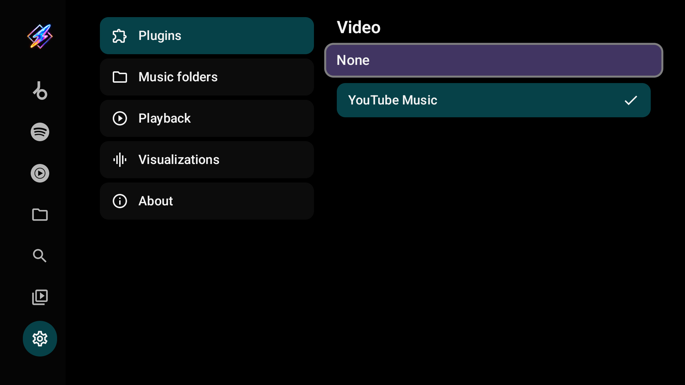

Under **Video**, choose which plugin supplies videos, or **None**.

## Spotify with YouTube audio

Sign in to Spotify and keep YouTube enabled under Audio. Spotify supplies the catalog and playlists; YouTube supplies a matched recording, which can differ from the catalog entry. The queue then continues with the matched track's YouTube radio.

## Prepare private playlists

### Why prepare a YouTube playlist?

The purpose is music discovery: give YouTube's radio and autoplay a reference for your whole Spotify playlist, so the continuation can follow the collection's sound rather than just its opening song.

| Setting | What YouTube receives for the continuation |
| --- | --- |
| **Off** | The matched YouTube ID of the playlist's first song. Milkbeat asks YouTube for that song's radio, then appends suggestions after your Spotify queue. |
| **On** | A native YouTube Music playlist containing the matched Spotify songs. Milkbeat plays that copy and requests autoplay in the playlist's context, giving YouTube the complete collection as a reference. |

YouTube supplies the recommendations in both cases. Its system uses several signals, including playlists; the result is generated by YouTube, not a local shuffle or a radio model trained by Milkbeat. [YouTube's playlist explanation](https://support.google.com/youtube/answer/7665542?hl=en).

Preparing the whole playlist also gives Milkbeat YouTube IDs for every matched song, so it can exclude songs already in the playlist from the radio continuation and remove repeated suggestions. This helps avoid hearing playlist tracks again as the mix begins. Radio still stays outside the private copy: choosing a preset such as **Popular**, **Discover** or **Deep cuts** changes future recommendations, not either playlist's contents.

Whatever you play continues as a radio, and every radio offers all the presets YouTube Music has for it, pinned in one scrolling line at the top of the queue. Press Right on a queue track to reach them, Left and Right to move along them, and Down to return to the track you left.

### Enable preparation

This option is **off by default** and requires Milkbeat 0.9.0 or later, Spotify and an audio plugin that can hold private playlists, both enabled and signed in. Under Spotify, the option appears once for each such plugin, named after it. The retired YouTube Music plugin (0.2.1 or later) supports it; the YouTube plugin 0.1.3 does not, so with only YouTube installed the option is absent and Spotify playlists use normal matching and radio. Plugins without playlist-preparation support keep their other playback features.

1. Open **Settings → Plugins → Spotify**.
2. Enable **Prepare private playlists in** *plugin*, for example **Prepare private playlists in YouTube Music**.
3. Let your own Spotify playlists and Liked Songs prepare in the background. Other playlists, including generated mixes, begin preparing when you open them.
4. Select Play or a track. If syncing is still in progress, Milkbeat shows a short message that playback will start when the playlist is ready. The page shows percentage progress through matching, writing and verification, plus unavailable tracks. Once the copy is ready, a small YouTube mark appears beside **Private playlist ready**: playing the playlist then uses its private YouTube Music copy. Select **Retry preparation** if it fails.

   

   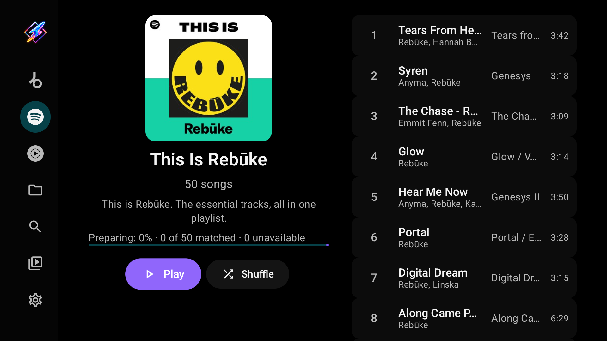
   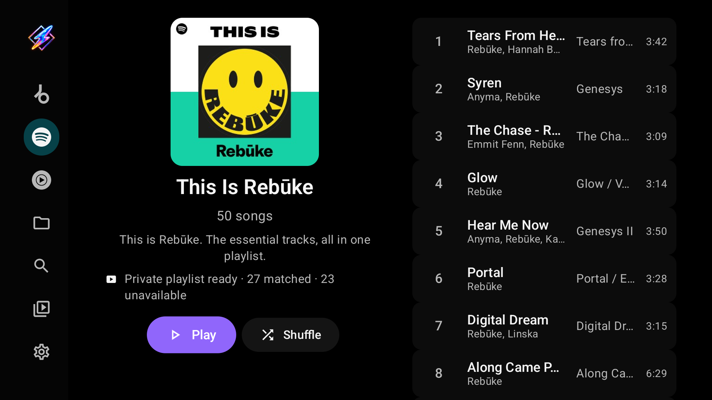
   

Milkbeat creates private YouTube copies with the source playlist cover, resolves the source songs, then adds the matched songs together and verifies the copy. With a Milkbeat build that supports batch matching and a plugin that supports it (YouTube Music 0.2.3 or later), matching runs in bounded parallel batches while the empty copy is prepared. Recording title, performer and named remix/edit checks reject conflicting candidates. Remixer credits can appear in the title or artist list, and explicitly listed members can identify a collective artist credit regardless of their order. Longer recordings have no duration cap or required full/extended label when the recording title, performers and named remix/edit agree; full versions are preferred over mixed excerpts. Shorter conflicting excerpts are rejected. Additional searches run only when the first search has no acceptable match. Older compatible plugins retain sequential matching. Copies refresh from Spotify in one direction and preserve track order and duplicate occurrences. Confidently unmatched songs are left out of the copy; temporary connection failures remain retryable. Spotify's playlists are not edited. Background refresh is scheduled approximately every six hours, subject to network and device constraints; opening a ready playlist reuses its saved preparation for up to six hours, without fetching the source again, re-matching tracks or rewriting the YouTube copy. Older preparations, changed titles or covers, and unfinished preparations are checked again on open.

Managed copies are reused after restarting Milkbeat. When Spotify changes, Milkbeat updates the existing copy's songs and order instead of creating another same-name playlist. If a managed copy was deleted, preparation can create a replacement. Albums are not mirrored.

Only the source playlist's matched songs belong in the private copy. YouTube's autoplay and radio suggestions are added to Milkbeat's playback queue, outside that copy. Changing a radio mode does not change either playlist.

Prepared playback uses known YouTube IDs and native collection autoplay, while displaying Spotify's song metadata and catalog cover. [Artwork view](playback.md#visualizer-music-video-or-artwork) can show the accepted audio provider's playback thumbnail, falling back to that cover. Choosing a missing song starts at the next available match. Initial preparation can delay playback, especially for large playlists. Play shares any preparation already running on the page. Recently verified copies and their matches are reused across restarts. Previously unavailable songs are retried once when the matching rules change, so an old rejection does not hide a newly valid match. Interrupted work resumes from checkpoints.

Disable the option to return to normal matching and radio based on the first playing song. Existing private copies remain in your YouTube library. While Spotify is signed in, Library hides managed copies that duplicate their source playlists.
